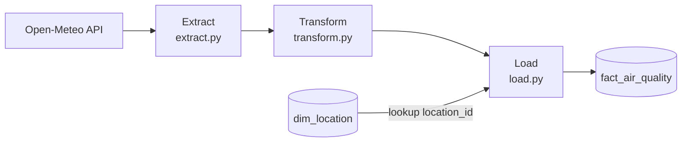

# Jakarta Air Quality ETL Pipeline

Sebuah Pipeline yang dibuat berdasarkan data kualitas udara Jakarta dari Open-Metio API, dicleaning lalu di simpan ke database MySQL dengan schema fact/Dimension.

## Alur

## Tech Stack
Python, Pandas, SQLAlchemy, MySQL (XAMPP), Open-Meteo API

## Skema Database
- `dim_location`: lokasi (nama, latitude, longitude)
- `fact_air_quality`: pengukuran per jam (PM10, PM2.5, NO2, ozon, kategori)

## Cara Menjalankan
1. Jalankan MySQL, lalu buat database dari `schema.sql`
2. `pip install -r requirements.txt`
3. `python pipeline.py`

## Catatan
Data dari Open-Meteo adalah keluaran model, dan jam yang belum terjadi
adalah prediksi, bukan pengukuran langsung.